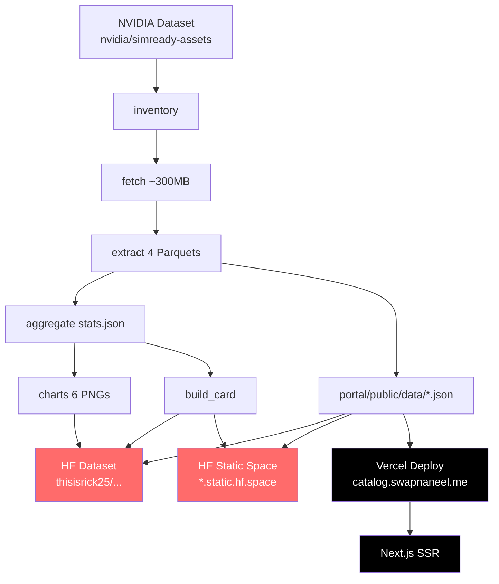

# SimReady Catalog

NVIDIA's [SimReady Assets](https://huggingface.co/datasets/nvidia/simready-assets) is a
489.68 GB dataset of 2,677 simulation-ready 3D models for robotics and Physical AI.
Every asset ships with tuned physics (mass, inertia, collision shapes), PBR materials,
and engine-specific variants for PhysX, MuJoCo, and Newton. The dataset is released
under CC-BY-4.0 -- but as of this writing, NVIDIA ships no dataset card, no summary
statistics, and no documentation beyond the assets themselves.

This project fills that gap. A seven-stage Python pipeline inventories the HuggingFace
repo, selectively downloads only the small text payloads (~300 MB out of 490 GB),
parses every asset's physics and validation metadata, and produces a full
[HuggingFace dataset card](card/README.md), summary statistics, charts, an
interactive [Next.js portal](portal/), and publishes everything to
HuggingFace.

## Related Repositories

- **GitHub repo:** [https://github.com/thisisrick25/nvidia-simready-catalog](https://github.com/thisisrick25/nvidia-simready-catalog)
- **HF Space:** [https://huggingface.co/spaces/thisisrick25/nvidia-simready-catalog](https://huggingface.co/spaces/thisisrick25/nvidia-simready-catalog) · [https://thisisrick25-nvidia-simready-catalog.static.hf.space](https://thisisrick25-nvidia-simready-catalog.static.hf.space/)
- **HF Dataset:** [https://huggingface.co/datasets/thisisrick25/nvidia-simready-catalog](https://huggingface.co/datasets/thisisrick25/nvidia-simready-catalog)
- **HF Dataset (source):** [https://huggingface.co/datasets/nvidia/simready-assets](https://huggingface.co/datasets/nvidia/simready-assets)
- **SimReady Foundation:** [https://github.com/NVIDIA/simready-foundation](https://github.com/NVIDIA/simready-foundation)
- **Isaac Sim:** [https://developer.nvidia.com/isaac/sim](https://developer.nvidia.com/isaac/sim)

## Key Findings

- **2,677 assets** across **14 taxonomy groups** (common_assets, props_food,
  props_isaac, omniverse, props_warehouse, and 9 others)
- **183,394 files** totaling 489.68 GB, but the pipeline only needs ~300 MB of
  `.usda` text payloads to extract everything
- Every successfully parsed asset has **PhysX, MuJoCo, and Newton** physics variants
  (2,669 of 2,677; the remaining 8 have no payload files)
- **5 articulated assets** with joints and motors
- Median mass **0.92 kg**; 22 outliers exceed 5,000 kg (up to ~952,000 kg for a
  warehouse module) -- almost certainly authoring defects in NVIDIA's source USD
- **55.6% validation pass rate** across FET features; top failing requirements are
  RB.MB.001, AA.001, and VM.MDL.001
- Deploy dates span **2026-10-08 to 2026-10-29**, with the bulk (2,138 assets)
  packaged on 2026-10-09
- Licensed **CC-BY-4.0**

## Quick Start

```bash
pip install -e .[dev]
export HF_TOKEN=hf_...           # read-only token; needed for gated downloads
python -m pipeline.run_all
```

For a fast smoke test that downloads only a handful of assets:

```bash
python -m pipeline.run_all --limit 5
```

You can also skip stages you've already run:

```bash
python -m pipeline.run_all --skip-inventory --skip-fetch
```

**What you get:**

| Output | Description |
|--------|-------------|
| `data/assets.parquet` | One row per asset with 35 columns of metadata |
| `data/meshes.parquet` | Per-mesh physics (mass, inertia, collision shape) |
| `data/materials.parquet` | Per-material shader class and semantic tokens |
| `data/validation.parquet` | Per-feature validation pass/fail results |
| `data/stats.json` | Aggregated statistics for the whole dataset |
| `card/README.md` | Rendered HuggingFace dataset card |
| `card/assets/*.png` | Six charts (categories, mass, sizes, variants, validation, growth) |

## Portal (Next.js)

The Next.js portal (`portal/`) is the default interactive dashboard for exploring the catalog:

- **Overview tab**: KPI cards, mass/size histograms (log scale), variants bar chart, growth line chart, validation signal
- **Assets tab**: searchable, filterable, sortable table with thumbnails; category multiselect, validation filter, articulated filter; click row for detail sheet
- **Validation tab**: pass rates by feature (horizontal bar chart), top failing requirements table, assets with failures table
- **About tab**: attribution and links

Run locally:

```bash
cd portal && npm run dev
```

Or from repo root:

```bash
npm run portal
```

The portal reads JSON data from `portal/public/data/` (generated by the pipeline).

The portal's static export is generated in Next.js's default `portal/out/`
directory. Run `npm run build` from `portal/` (or `npm run portal:build` from
the repository root) to generate it.

## Portal (Gradio - Legacy)

The Gradio portal (`portal/app.py`) provides an alternative dashboard with similar features. It carries its own copy of the data in `portal/data/` for HF Space deployment.

Run locally:

```bash
python portal/app.py
```

For a fast smoke test that downloads only a handful of assets:

```bash
python -m pipeline.run_all --limit 5
```

You can also skip stages you've already run:

```bash
python -m pipeline.run_all --skip-inventory --skip-fetch
```

**What you get:**

| Output | Description |
|--------|-------------|
| `data/assets.parquet` | One row per asset with 35 columns of metadata |
| `data/meshes.parquet` | Per-mesh physics (mass, inertia, collision shape) |
| `data/materials.parquet` | Per-material shader class and semantic tokens |
| `data/validation.parquet` | Per-feature validation pass/fail results |
| `data/stats.json` | Aggregated statistics for the whole dataset |
| `card/README.md` | Rendered HuggingFace dataset card |
| `card/assets/*.png` | Six charts (categories, mass, sizes, variants, validation, growth) |

## Architecture

The pipeline parses USDA files with regular expressions rather than importing the
`pxr` USD library, so the only dependencies are standard data-science packages
(`pandas`, `matplotlib`, `pyarrow`). This keeps the install lightweight and avoids
the heavy `usd-core` wheel. Binary USD enrichment via `pxr` is supported but optional.

Each asset is extracted inside its own try/except -- one broken payload never crashes
the run. The `parse_status` column tracks the outcome per asset: `ok`,
`no_payloads`, `no_physics_payload`, or `parse_error`.



## Project Structure

```
simready-catalog/
├── pipeline/              # 7-stage analysis pipeline (11 modules)
│   ├── config.py          # Paths, HF repo ID, constants
│   ├── run_all.py         # Orchestrator (--limit, --skip-inventory, --skip-fetch)
│   ├── inventory.py       # Stage 1: file inventory from HF tree API
│   ├── fetch.py           # Stage 2: selective download via snapshot_download
│   ├── extract.py         # Stage 3: parse assets → 4 Parquet tables
│   ├── parse_usda.py      # Regex-based USDA text parser
│   ├── parse_usdc.py      # Optional binary USD parser (needs pxr)
│   ├── parse_packaging.py # Packaging JSON parser
│   ├── aggregate.py       # Stage 4: summary statistics → stats.json
│   ├── charts.py          # Stage 5: matplotlib chart generation
│   ├── build_card.py      # Stage 6: render HF dataset card
│   └── publish.py         # Stage 7: upload to HuggingFace
├── portal/                # Existing Gradio Space
│   ├── app.py             # Dashboard UI
│   └── data/              # Self-contained data copy for HF Space deployment
├── portal/                # Next.js dashboard and Hugging Face Static Space
│   ├── app/               # Dashboard UI and styles
│   └── public/data/       # Browser-sized catalog exports
├── card/                  # Generated dataset card + chart images
├── tests/                 # pytest suite (9 files, 26+ tests, real fixtures)
├── data/                  # Pipeline output (gitignored, regenerable)
└── pyproject.toml         # dependencies and project metadata
```

## Pipeline Deep Dive

### Stage 1 -- Inventory

`inventory.py` calls the HuggingFace tree API to list every file in the dataset repo
without downloading anything. Each of the 183,394 files is classified by kind
(payload_usda, packaging_json, thumbnail, texture, geometry, metadata, etc.) and
written to `data/inventory.parquet`.

### Stage 2 -- Fetch

`fetch.py` uses `huggingface_hub.snapshot_download()` with `allow_patterns` to pull
only the files the pipeline needs: `.usda` payloads, `sm_*.usd` scene files,
packaging JSONs, metadata, and thumbnails. This brings down roughly 300 MB instead
of the full 490 GB. The `--limit N` flag restricts the download to the first N
assets for quick iteration.

### Stage 3 -- Extract

`extract.py` walks every downloaded asset directory and parses:

- **Physics payload** (`instances_physx.usda` preferred, falling back to Newton,
  MuJoCo, or generic `instances.usda`): header metadata, per-mesh mass/inertia/
  collision shape, joints, articulation, validation results, materials
- **Packaging JSON**: license, package ID, deploy date, SHA-256 hashes
- **Binary USD** (optional): `asset_info` from the default prim via `pxr.Usd`

Output: four Parquet tables (`assets`, `meshes`, `materials`, `validation`).

### Stage 4 -- Aggregate

`aggregate.py` reads the four tables and computes summary statistics: asset counts,
category distribution, variant coverage, articulation percentages, mass stats with
outlier flagging at the 5,000 kg threshold, validation pass rates per FET feature,
top failing requirements, size distribution, and a growth timeline by deploy date.
Output: `data/stats.json`.

### Stage 5 -- Charts

`charts.py` generates six matplotlib PNGs in NVIDIA green (#76b900): category bar
chart, mass histogram (log scale), size histogram (log scale), variant coverage,
validation pass rates, and cumulative growth over time.

### Stage 6 -- Build Card

`build_card.py` renders a full HuggingFace dataset card as Markdown with YAML front
matter, at-a-glance stats table, category breakdown, physics summary, heaviest/
lightest asset tables, variant coverage, validation results, growth timeline, usage
examples (Isaac Sim, usd-core Python, MuJoCo), BibTeX citation, and license info.

### Stage 7 -- Publish

`publish.py` uploads the generated artifacts to HuggingFace. It publishes the
dataset card and Parquet tables as a HF dataset, and the Gradio portal as a
HF Space. Requires a write-access `HF_TOKEN`.

```bash
python -m pipeline.publish --namespace thisisrick25 --what both
```

## Portal

The Gradio portal (`portal/app.py`) provides an interactive dashboard for
exploring the catalog:

- **Overview tab**: category distribution, mass histogram, variant coverage, and
  cumulative growth charts
- **Assets tab**: searchable, filterable table with category multiselect and text
  search; columns include mass, rigid body count, articulation status, validation
  results, and hotlinked thumbnails
- **Validation tab**: pass rate per FET feature, list of failing assets, and
  per-asset drilldown into failing requirements
- **About tab**: attribution and links

The portal carries its own copy of the data in `portal/data/` so it can be deployed
as a standalone HuggingFace Space without the rest of the repo.

Run locally:

```bash
python portal/app.py
```

## Testing

Run the full test suite from the repo root:

```bash
pytest
```

The test suite has 11 files with 39+ tests covering every pipeline stage. Tests use
real USDA and JSON fixtures (a banana asset) from `tests/fixtures/` rather than
mocks, so they exercise the actual parsing logic. No additional dependencies beyond
`pyproject.toml` are needed.

## Contributing

1. Fork the repo and create a feature branch
2. Make your changes
3. Run `pytest` and confirm all tests pass
4. Open a pull request

The `data/` directory is gitignored -- it is fully regenerable by running the
pipeline. Do not commit generated data files.

## License

The upstream NVIDIA SimReady Assets dataset is licensed
[CC-BY-4.0](https://creativecommons.org/licenses/by/4.0/).

All statistics and outputs produced by this project are derived from that dataset and
carry the same attribution requirement. See the
[generated dataset card](card/README.md) for full attribution and citation details.
