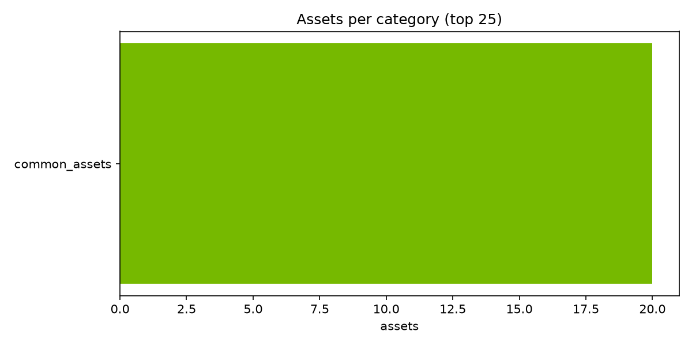
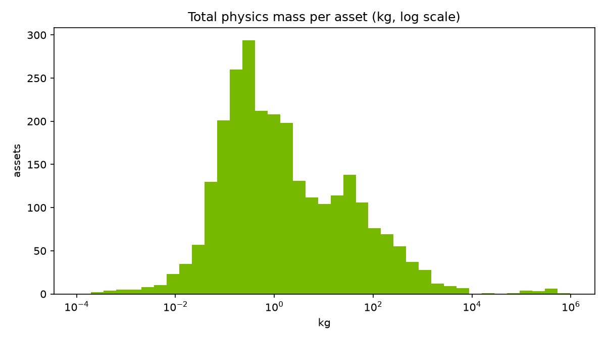
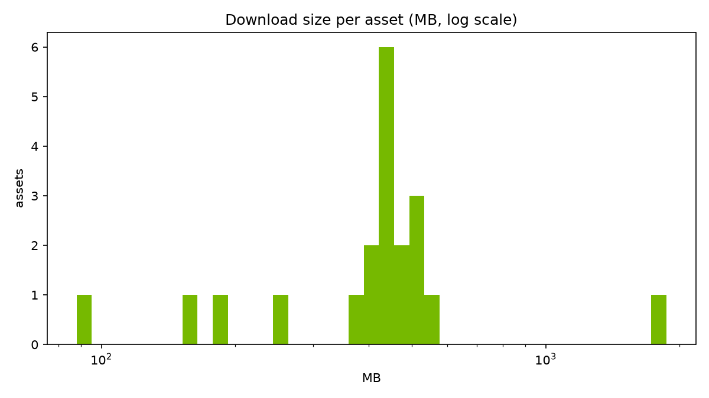
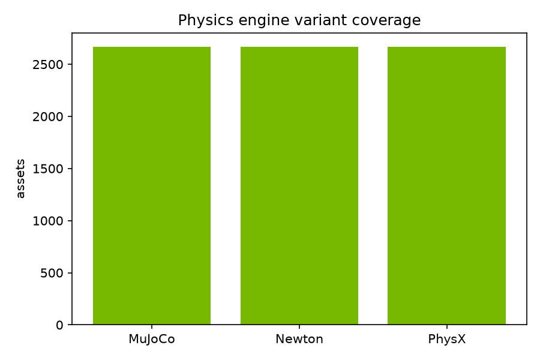
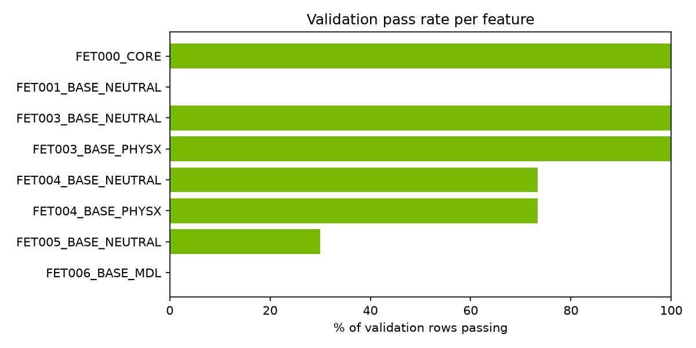
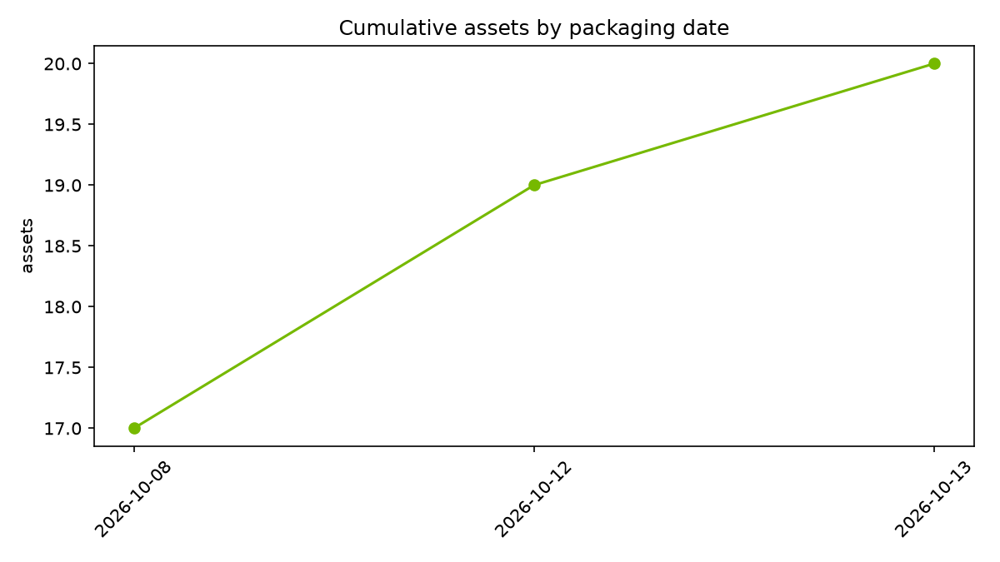

# NVIDIA SimReady Assets — Community Dataset Card

> [!NOTE]
> This card was produced by the community catalog project and offered to NVIDIA; numbers are computed programmatically from the repo tree and payload files on 2026-11-03. Verify against https://huggingface.co/datasets/nvidia/simready-assets for the latest state.

NVIDIA's **SimReady Assets** are simulation-ready 3D models for robotics and Physical AI: every asset ships with tuned physics (mass, inertia, collision approximations), materials, and variants for **PhysX**, **MuJoCo**, and **Newton** physics engines. The dataset contains **2,677 assets** totaling **489.68 GB** under **CC-BY-4.0**.

## Dataset at a glance

|  |  |
|---|---|
| Assets | 2,677 |
| Total size | 489.68 GB |
| Files | 183,398 |
| Categories | 14 |
| Articulated assets | 5 (0.2%) |
| PhysX variant | 2,669 |
| MuJoCo variant | 2,669 |
| Newton variant | 2,669 |
| License | CC-BY-4.0 |
| Data as of | 2026-11-03 |

## Directory structure

Each asset lives in its own top-level directory:

```
<asset_name>/
├── com.nvidia.simready.packaging.json   # package id, license, sha256 hashes
├── .metadata/                           # bill of materials
├── simready_usd/
│   ├── sm_<asset_name>_01.usd           # main SimReady USD (binary USDC)
│   ├── payloads/
│   │   ├── base.usda                    # structure + variant sets
│   │   ├── instances.usda               # per-mesh physics (neutral)
│   │   ├── instances_physx.usda          # per-mesh physics (PhysX)
│   │   ├── instances_mujoco.usda         # per-mesh physics (MuJoCo)
│   │   ├── instances_newton.usda         # per-mesh physics (Newton)
│   │   ├── materials.usda                # material definitions
│   │   ├── geometries.usd                # mesh data (the big file)
│   │   └── PhysX/ MuJoCo/ Newton/ Physics/   # engine payload subdirs
│   ├── source_assets/                    # original DCC files
│   └── Textures/
└── .thumbs/256x256/                     # rendered thumbnails (lit/unlit)
```

**Tip:** for metadata and physics you only need the small text `.usda` payload files; `geometries.usd` holds the mesh data and dominates download size.

## Naming conventions

Asset names follow `<category>_<type>_<variant>` (e.g. `food_produce_banana_m01`, `appliance_dishwasher_a01`). Variant suffixes (`a01`, `b01`, `m01`, ...) distinguish design variants of the same object type. See NVIDIA's naming guide in the [simready-foundation](https://github.com/NVIDIA/simready-foundation) repo for the authoritative conventions.

## What's in the catalog

| Category (taxonomy group) | Assets |
|---|---|
| common_assets | 2,314 |
| props_isaac | 92 |
| props_food | 91 |
| omniverse | 85 |
| props_warehouse | 32 |
| SIM_READY | 32 |
| props_kitchenware | 6 |
| props_automotive_workshop_tools | 5 |
| props_softbody | 4 |
| props_endeavor_kitchen | 3 |
| props_automotive_parts | 2 |
| props_automotive_equipment | 1 |
| props_kitchen_france | 1 |
| props_hospital | 1 |



## Physics

Per-mesh physics properties (`physics:mass`, `physics:centerOfMass`, `physics:diagonalInertia`, collision `physics:approximation`) are authored in the `instances_*.usda` payloads. Asset mass below is the sum of per-mesh masses from the PhysX instance file.

| Mass (per-asset sum) | Value |
|---|---|
| Minimum | 0.000109254 kg |
| Median | 0.923211 kg |
| Mean | 1790.49 kg |
| Maximum | 952461 kg |

> [!WARNING]
> **Known data quality note:** 22 assets (0.82%) report a summed mass above 5000 kg (e.g. warehouse structural modules, an exhaust manifold at ~500,000 kg) — these look like authoring/export defects in NVIDIA's source USD rather than real weights. We report the numbers as-is, unmodified; use the **median** above rather than the mean when reasoning about a typical asset.

Collision approximations in use: `convexDecomposition` (9), `sdf` (10,658)




### Heaviest assets

| Asset | Mass (kg) |
|---|---|
| modular_warehouse_h10m_corner_out_a01 | 952461 |
| exhaustSystem_exhaust_manifold_f01 | 501226 |
| modular_warehouse_h10m_straight_90_a04 | 404025 |
| warehouse_h10m_straight_90_a04 | 400081 |
| warehouse_h10m_straight_a04 | 399748 |
| modular_warehouse_h10m_straight_a04 | 398601 |
| modular_warehouse_h10m_center_a01 | 302944 |
| set_office_main_a01 | 267161 |
| structure_wall_corner_a01 | 217653 |
| structure_wall_entrance_a01 | 192774 |

### Lightest assets

| Asset | Mass (kg) |
|---|---|
| hardware_bearing_caster_a01 | 0.000109254 |
| factory_nut_m4_loose | 0.000267644 |
| factory_nut_m4_tight | 0.000268642 |
| hardware_screw_95_a01 | 0.000406182 |
| hardware_screw_99_physics_a01 | 0.0005 |
| factory_bolt_m04_loose | 0.00063011 |
| screw_high_res | 0.000635557 |
| factory_bolt_m04_tight | 0.000651707 |
| hardware_bearingPin_a01 | 0.000784414 |
| factory_nut_m8_loose | 0.000992802 |

## Physics engine variants

Each asset declares MuJoCo / Newton / PhysX physics variants in `base.usda` (`Variants → Physics`), so the same asset can be simulated in any of the three engines:



## Validation (SimReady Foundation)

Assets embed their own validation results (`SimReady_Metadata → validation`), produced by NVIDIA's [simready-foundation](https://github.com/NVIDIA/simready-foundation) tooling against the `Robotics-Prop` profile. Overall pass rate across parsed validation rows: **55.6%**.

| Feature | Pass rate | Passed / total |
|---|---|---|
| FET000_CORE | 91.8% | 3,187 / 3,471 |
| FET001_BASE_NEUTRAL | 1.5% | 54 / 3,690 |
| FET003_BASE_NEUTRAL | 99.9% | 3,684 / 3,689 |
| FET003_BASE_PHYSX | 99.3% | 3,610 / 3,637 |
| FET004_BASE_NEUTRAL | 42.6% | 1,571 / 3,690 |
| FET004_BASE_PHYSX | 42.3% | 1,538 / 3,637 |
| FET005_BASE_NEUTRAL | 65.4% | 2,412 / 3,690 |
| FET006_BASE_MDL | 1.2% | 40 / 3,470 |
| FET100_BASE_ISAACSIM | 0.0% | 0 / 1 |

Most common failing requirements:

| Failing requirement | Occurrences |
|---|---|
| RB.MB.001 | 3,973 |
| AA.001 | 3,464 |
| VM.MDL.001 | 3,417 |
| GSP.001 | 1,190 |
| NP.008 | 169 |
| HI.009 | 83 |
| COL.001 | 38 |
| VM.MAT.001 | 25 |
| RB.001 | 20 |
| NP.005 | 9 |
| VM.TEX.002 | 3 |
| PMT.001 | 3 |
| NP.006 | 2 |
| JT.002 | 2 |
| ISA.001 | 1 |



## Growth

Packaging dates extracted from package IDs run 2026-10-08 → 2026-11-02:



## How to use

**Isaac Sim / Omniverse:** add the dataset as a local or cloud asset root; `sm_*.usd` files are drop-in placeable with physics already tuned.

**Plain OpenUSD (Python):**
```python
# pip install usd-core
from pxr import Usd, UsdPhysics
stage = Usd.Stage.Open("food_produce_banana_m01/simready_usd/sm_food_produce_banana_m01_01.usd")
for prim in stage.Traverse():
    mass = UsdPhysics.MassAPI(prim)
    if mass:
        print(prim.GetPath(), mass.GetMassAttr().Get())
```

**MuJoCo / Newton:** load the same `sm_*.usd` and activate the MuJoCo (or Newton) physics variant; or use `payloads/instances_mujoco.usda` directly.

## License & attribution

The assets are © NVIDIA Corporation, licensed [CC-BY-4.0](https://creativecommons.org/licenses/by/4.0/). When using assets (or derived data such as this catalog), credit "NVIDIA SimReady Assets" and link to https://huggingface.co/datasets/nvidia/simready-assets.

## Citation

```bibtex
@dataset{nvidia_simready_assets,
  title  = {NVIDIA SimReady Assets},
  author = {NVIDIA Corporation},
  year   = {2026},
  url    = {https://huggingface.co/datasets/nvidia/simready-assets},
  license = {CC-BY-4.0}
}
```

## Companion Resources

- **GitHub repo:** https://github.com/thisisrick25/nvidia-simready-catalog
- **HF Space:** https://huggingface.co/spaces/thisisrick25/nvidia-simready-catalog · https://thisisrick25-nvidia-simready-catalog.static.hf.space
- **HF Dataset:** https://huggingface.co/datasets/thisisrick25/nvidia-simready-catalog
- **HF Dataset (source):** https://huggingface.co/datasets/nvidia/simready-assets
- **SimReady Foundation:** https://github.com/NVIDIA/simready-foundation
- **Isaac Sim:** https://developer.nvidia.com/isaac/sim
